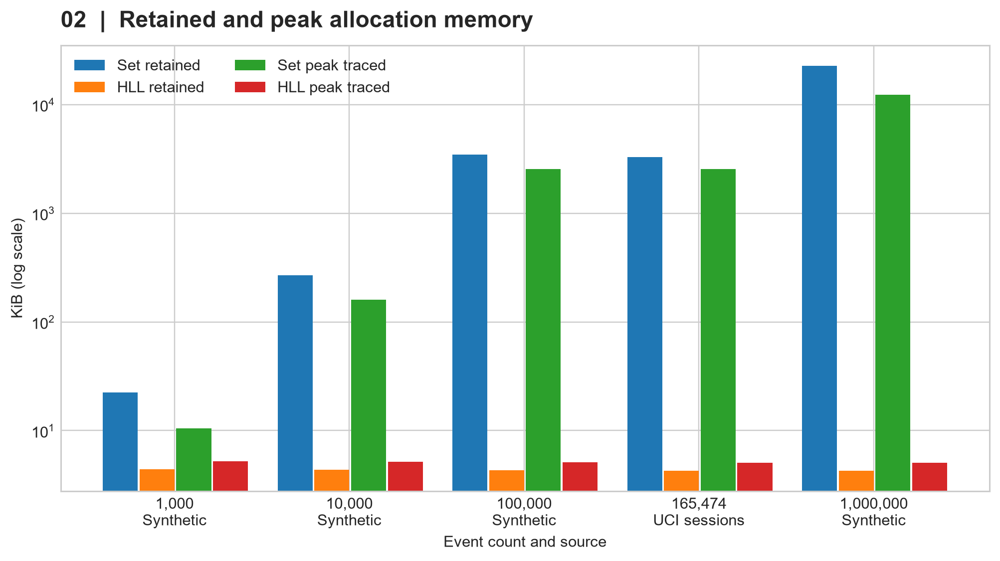
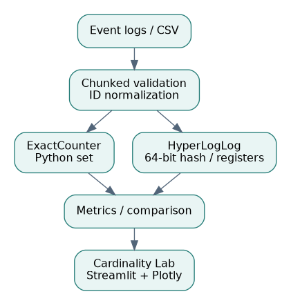

# Cardinality Lab

Memory-Efficient Unique Visitor Estimation System — an SDS mini project implementing HyperLogLog from scratch and comparing it with exact Python Set counting.

## Highlights
- Deterministic 64-bit BLAKE2b hashing, configurable precision, linear counting, compatible sketch merging.
- Four reproducible synthetic datasets up to one million events and a real UCI session dataset.
- Five timing repetitions, retained memory and traced peak allocation, 100 precision observations.
- Dark-mode Streamlit dashboard with six sections and interactive charts.

## Local benchmark highlights
| Dataset | Exact | Estimate | Error | Retained memory ratio |
|---|---:|---:|---:|---:|
| 1M synthetic events | 250,000 | 245,263 | 1.895% | 5,337.74x |
| UCI 165,474 events | 24,026 | 24,034 | 0.034% | 775.92x |

The set was faster in this implementation; HLL reduces retained memory, not necessarily latency. UCI IDs represent sessions, not people. Peak traced allocation is not total process RAM.



## Run locally (Windows PowerShell)
```powershell
py -3 -m venv .venv
.\.venv\Scripts\python.exe -m pip install -r requirements-dashboard.txt
.\.venv\Scripts\python.exe -m scripts.generate_benchmarks
.\.venv\Scripts\python.exe -m scripts.prepare_real
.\.venv\Scripts\python.exe -m pytest -q
.\.venv\Scripts\python.exe -m scripts.run_benchmarks
.\.venv\Scripts\python.exe -m scripts.plot_benchmarks
.\.venv\Scripts\python.exe -m streamlit run app.py
```
Real dataset acquisition needs internet; synthetic workloads are sufficient for offline benchmarking. On macOS/Linux use `.venv/bin/python`. The dashboard runs at http://localhost:8501. Raw and generated CSVs are omitted and reproducible.

## Documentation
- [Complete project context](PROJECT_MASTER_CONTEXT.md)
- [Dataset source and attribution](docs/dataset.md)
- [Academic report](docs/SDS_Project_Report.docx) and [presentation](docs/SDS_Project_Presentation.pptx)
- [Viva and demo](docs/Viva_and_Demonstration.md)
- [Local results](results/phase_5_6) and [figures](visualizations/phase_5_6)

## Architecture

