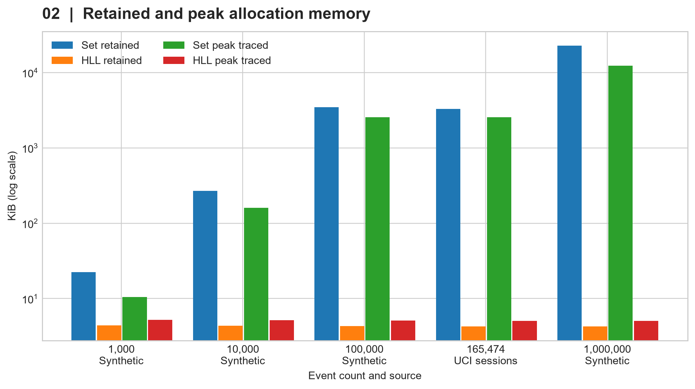
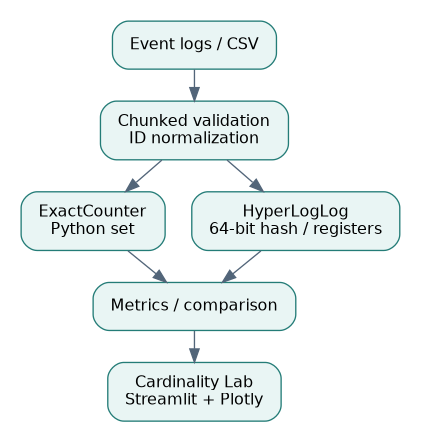
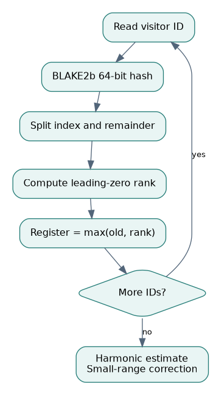
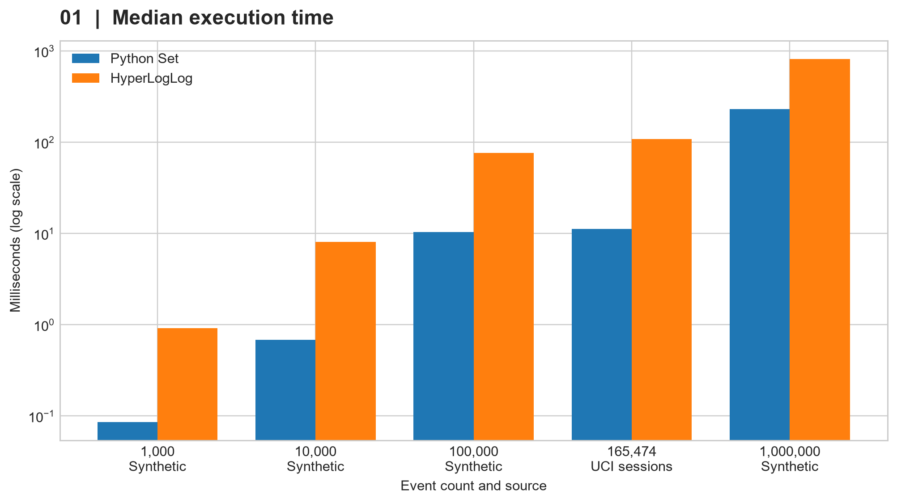
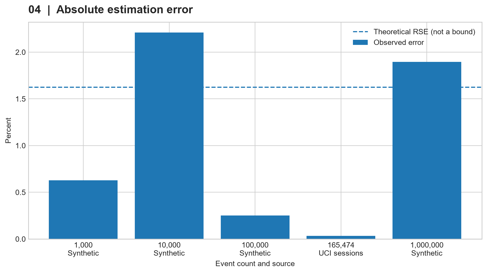
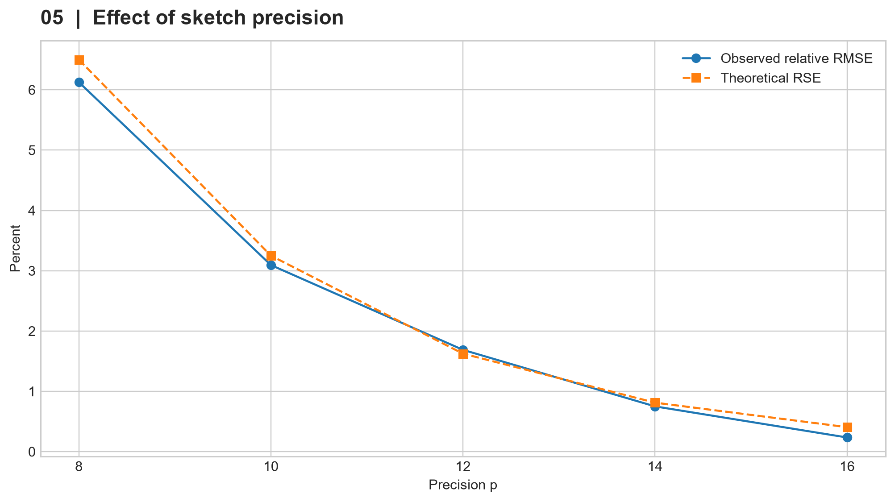

# Cardinality Lab

### Memory-Efficient Unique Visitor Estimation System

   

**Count distinct visitors without retaining every visitor ID.**

Cardinality Lab is an SDS mini project exploring probabilistic cardinality estimation for large website event streams. It implements **HyperLogLog (HLL) from scratch**, compares it against exact Python Set counting, and exposes the memory–accuracy–runtime trade-off through an interactive analytics dashboard.

[Results](#benchmark-results) · [Architecture](#system-architecture) · [Dashboard](#interactive-dashboard) · [Quick start](#quick-start) · [Documentation](#documentation)

## Key findings

| Metric | Measured result |
|---|---:|
| Largest workload | 1,000,000 events |
| Retained memory reduction at largest workload | **5,337.74×** |
| Retained memory savings at largest workload | **99.9813%** |
| HLL register storage (p = 12) | 4 KiB |
| Real-world UCI session estimation error | **0.034%** |

These measurements come from the local Windows benchmark, not hypothetical results. The largest workload had 250,000 distinct IDs; the HLL estimate was approximately 245,263 (1.895% error).



## Why HyperLogLog?

An exact set stores every distinct identifier. Its memory requirement therefore grows with cardinality. HyperLogLog instead stores a fixed number of small registers and estimates cardinality using hash-bit patterns. Duplicate IDs do not increase its register storage.

| Property | Python Set | HyperLogLog |
|---|---|---|
| Count | Exact | Approximate |
| Space | O(u), u distinct IDs | O(m), m registers |
| Insertion | O(1) average | O(1) for fixed-width hash and bounded ID length |
| Count retrieval | O(1) | O(m) |
| Union | Merge actual IDs | Register-wise maximum |
| Retains original IDs | Yes | No |

The implementation uses deterministic 64-bit BLAKE2b hashing, configurable precision, a bytearray register representation, harmonic-mean estimation and small-range linear counting. It does not depend on an external HLL library.

## System architecture



CSV event logs are validated and processed into identifier streams. Exact counting and HyperLogLog consume equivalent inputs, benchmark metrics are exported as CSV/JSON, and Streamlit presents the results.

<details>
<summary>HyperLogLog algorithm flow</summary>



1. Hash each identifier into 64 bits.
2. Use the first p bits to select a register.
3. Compute the leading-zero rank of the remaining bits.
4. Store the maximum rank observed for that register.
5. Estimate cardinality using all registers, applying linear counting for small ranges when appropriate.

The default precision is p = 12: 4,096 one-byte registers and a theoretical relative standard error of 1.625%. This is not a guaranteed error bound.

</details>

## Interactive dashboard

The dark-mode Streamlit application integrates six sections:

| Section | Functionality |
|---|---|
| Overview | Project metrics, workflow and performance highlights |
| Live Estimation | CSV upload, identifier selection, precision controls, HLL-only or exact comparison, result downloads |
| Performance Benchmarking | Interactive scalability, runtime, accuracy and memory charts |
| Precision Analysis | Observed versus theoretical error and memory trade-offs |
| Distributed Sketch Merging | Combine sketches and verify against a direct union sketch |
| Dataset Explorer | Preview records, inspect columns and export samples |

The app uses Python, Pandas, NumPy, Streamlit, Plotly and Matplotlib. Pytest supports automated verification.

## Datasets

| Source | Events | Distinct IDs | Identifier type |
|---|---:|---:|---|
| Synthetic | 1,000 | 250 | Generated visitor IDs |
| Synthetic | 10,000 | 2,500 | Generated visitor IDs |
| Synthetic | 100,000 | 25,000 | Generated visitor IDs |
| Synthetic | 1,000,000 | 250,000 | Generated visitor IDs |
| UCI Clickstream | 165,474 | 24,026 | Session IDs |

Synthetic workloads use seed 42 and guarantee 25% distinct IDs in each independent dataset. The real dataset is [UCI Clickstream Data for Online Shopping](https://archive.ics.uci.edu/dataset/553/clickstream+data+for+online+shopping), licensed CC BY 4.0. Its IDs identify **sessions, not individual people**. A GA4 BigQuery export query is also provided as an alternative, but GA4 was not used in the reported benchmarks.

CSV schema: `visitor_id`, `timestamp`, `page_url`, `event_type`. Repeated valid IDs are retained. Downloaded and generated CSVs are excluded from the repository and can be reproduced using the scripts.

## Benchmark results

### Scalability and accuracy

Measured on Windows with Python 3.11, default precision p = 12. Times are medians of five runs, excluding CSV loading and memory instrumentation.

| Events | Exact count | HLL estimate | Absolute error | Set time (ms) | HLL time (ms) | Memory reduction |
|---:|---:|---:|---:|---:|---:|---:|
| 1,000 | 250 | 252 | 0.628% | 0.085 | 0.920 | 5.06× |
| 10,000 | 2,500 | 2,445 | 2.210% | 0.680 | 8.090 | 61.69× |
| 100,000 | 25,000 | 25,063 | 0.253% | 10.414 | 76.672 | 807.77× |
| 165,474 (UCI) | 24,026 | 24,034 | 0.034% | 11.222 | 108.394 | 775.92× |
| 1,000,000 | 250,000 | 245,263 | 1.895% | 229.896 | 816.481 | 5,337.74× |

Estimates are rounded for display; errors use unrounded estimates. At one million events the retained Set size was approximately 22.20 MiB versus 4.26 KiB for HLL. **The Python Set was faster in this implementation**; HLL's demonstrated advantage is memory efficiency rather than latency.




### Precision and memory trade-off

Twenty independent ID sets of 25,000 distinct IDs were tested at each precision (100 observations total).

| p | Register storage | Mean absolute error | Relative RMSE | Theoretical RSE |
|---:|---:|---:|---:|---:|
| 8 | 256 B | 4.828% | 6.127% | 6.500% |
| 10 | 1 KiB | 2.550% | 3.094% | 3.250% |
| 12 | 4 KiB | 1.344% | 1.688% | 1.625% |
| 14 | 16 KiB | 0.598% | 0.751% | 0.813% |
| 16 | 64 KiB | 0.191% | 0.235% | 0.406% |



### Distributed sketch merging

Two compatible sketches were merged using register-wise maxima. The experiment returned identical registers to a sketch built directly over the union: actual union **15,000**, merged estimate **15,008.87**. Compatible sketches must use the same precision and hashing scheme.

See [all eight figures](visualizations/phase_5_6/) and [raw benchmark results](results/phase_5_6/).

## Quick start

Clone the repository and open the directory containing `app.py`. Use Python 3.11 (the benchmarked version).

```bash
git clone https://github.com/Sarvesh7125/memory-efficient-unique-visitor-estimation-system.git
cd memory-efficient-unique-visitor-estimation-system
```

If the project is still nested inside `Cardinality-Lab`, enter that folder before running the remaining commands.

### Windows (PowerShell)

```powershell
py -3 -m venv .venv
.\.venv\Scripts\python.exe -m pip install -r requirements-dashboard.txt
.\.venv\Scripts\python.exe -m scripts.generate_benchmarks
.\.venv\Scripts\python.exe -m streamlit run app.py
```

### macOS / Linux

```bash
python3 -m venv .venv
.venv/bin/python -m pip install -r requirements-dashboard.txt
.venv/bin/python -m scripts.generate_benchmarks
.venv/bin/python -m streamlit run app.py
```

Open **http://localhost:8501**. Synthetic data generation requires no external dataset download.

### Reproduce the experiments (Windows)

```powershell
.\.venv\Scripts\python.exe -m scripts.prepare_real
.\.venv\Scripts\python.exe -m pytest -q
.\.venv\Scripts\python.exe -m scripts.verify_algorithms
.\.venv\Scripts\python.exe -m scripts.run_benchmarks
.\.venv\Scripts\python.exe -m scripts.plot_benchmarks
```

Real dataset acquisition requires internet. Skip the first command for synthetic-only experiments. On macOS/Linux replace the Python executable with `.venv/bin/python`. Rerunning benchmarks may update the local results and graphs.

## Repository structure

```text
.
├── .streamlit/             # Dark-mode configuration
├── data/                   # Dataset metadata and generated inputs
├── docs/                   # Report, presentation, diagrams and methodology
├── results/                # CSV/JSON experimental evidence
├── scripts/                # Data generation, verification, benchmarks, plots
├── src/                    # HLL, exact counter, preprocessing, dashboard helpers
├── tests/                  # Automated correctness and integration tests
├── visualizations/         # Eight benchmark figures
├── app.py                  # Streamlit entry point
├── requirements.txt
├── requirements-dashboard.txt
└── PROJECT_MASTER_CONTEXT.md
```

## Limitations and future work

- HLL produces estimates rather than exact counts. Observed error varies with the data and precision.
- The UCI dataset measures sessions, not unique people.
- Retained object sizes are estimated; traced peak allocations exclude preloaded inputs and are not total process RSS.
- The custom Python HLL is slower than the built-in Set in these experiments. Native or vectorized implementations could improve throughput.
- Future extensions include time-windowed aggregation, distributed ingestion and evaluation on user-level GA4 logs.

## Documentation

- [Complete project context](PROJECT_MASTER_CONTEXT.md)
- [Dataset documentation and attribution](docs/dataset.md)
- [Academic report](docs/SDS_Project_Report.docx)
- [Project presentation](docs/SDS_Project_Presentation.pptx)
- [Viva and demonstration guide](docs/Viva_and_Demonstration.md)
- [Benchmark methodology](docs/phase_5_6.md)
- [Dashboard guide](docs/phase_7.md)

## References

- Philippe Flajolet et al. (2007). *HyperLogLog: the analysis of a near-optimal cardinality estimation algorithm*. [Paper](https://doi.org/10.46298/dmtcs.3545).
- UCI Machine Learning Repository (2019). *Clickstream Data for Online Shopping*. [Dataset page](https://archive.ics.uci.edu/dataset/553/clickstream+data+for+online+shopping) — see [dataset documentation](docs/dataset.md) for source details.

---

Built as an SDS academic mini project to demonstrate scalable probabilistic data structures, reproducible benchmarking and interactive data analytics.
